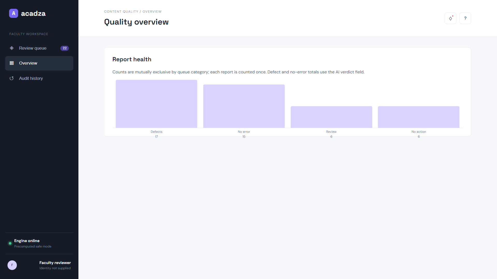
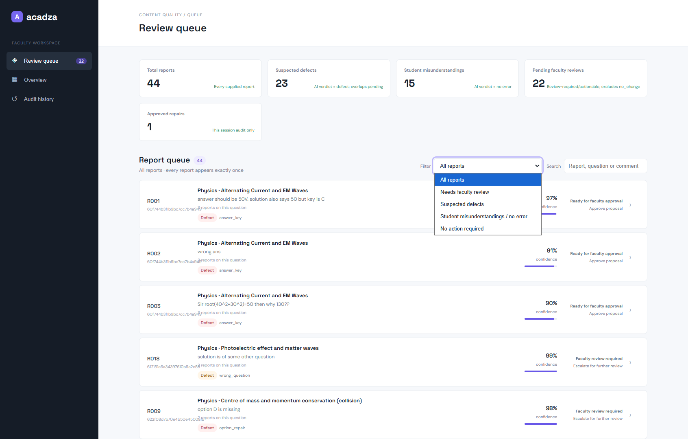
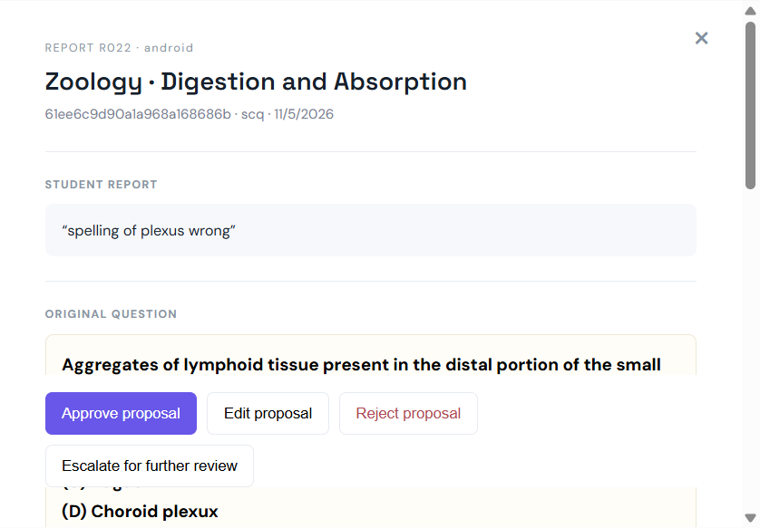
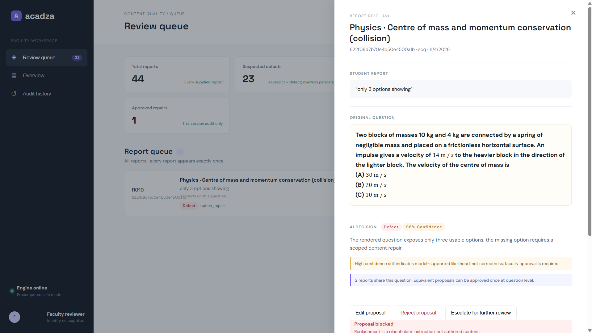
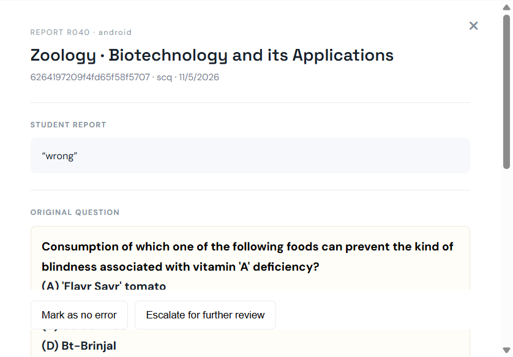
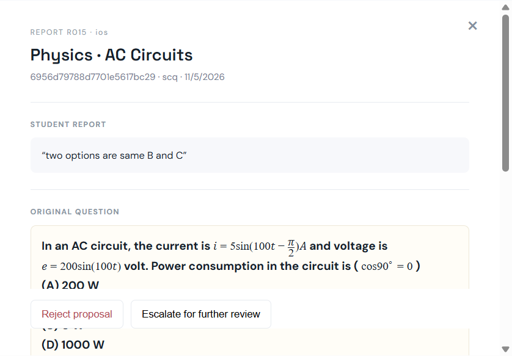
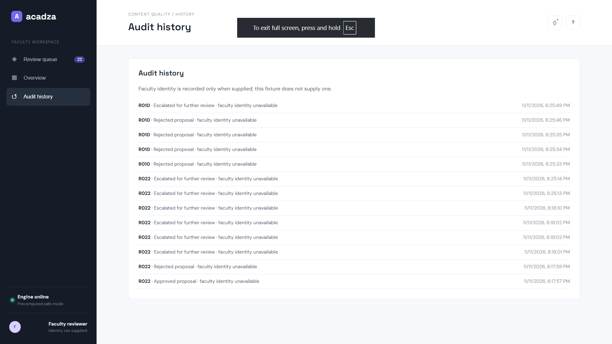

# Acadza AI Intern Assignment: "Report → Fix" Loop

**Deadline:** as stated in the email you received. **AI tools:** allowed and expected. **Stack:** your choice.

## Final Submission

- **GitHub Repository:** [https://github.com/Abijith-U0245/Acadza_AI](https://github.com/Abijith-U0245/Acadza_AI)
- **Live Application:** [https://acadza-report-fix-alpha.vercel.app/app/](https://acadza-report-fix-alpha.vercel.app/app/)
- **3-Minute Demo Video:** [https://drive.google.com/file/d/1WHTu-V9NNzvpD7EVQ8yHa4ob4KDVNVmQ/view?usp=sharing](https://drive.google.com/file/d/1WHTu-V9NNzvpD7EVQ8yHa4ob4KDVNVmQ/view?usp=sharing)

## Application Screenshots and Output Walkthrough

The screenshots below are genuine captures of the local faculty console using the
shipped reports, questions, and deterministic `results.json` output. The
application does not run an LLM at runtime: `scripts/triage.py` generates the
precomputed results using the `OVERRIDES` table.

### Dashboard Overview



The dashboard summarizes all 44 student reports and the resulting triage
categories, including suspected defects, no-error cases, pending faculty
reviews, and repairs approved in the current browser session.

### Faculty Review Queue



Faculty can browse the report list, filter cases, search by report or question
content, and identify related reports grouped around the same question.

### Valid Repair Proposal — R022



This is a narrow, source-grounded correction from `plexux` to `plexus`, with
evidence, confidence, validation status, and a before/after diff for explicit
faculty approval.

### Blocked Unsafe Proposal — R010



The console blocks a placeholder replacement instead of treating an instruction
such as `[replace with the correct question]` as approval-ready question
content.

### No-Error Case — R040



This case shows a no-error verdict and no proposed content edit because the
supplied evidence does not establish a defect.

### Faculty Review Case — R015



The identical-options issue remains on the faculty-review route because creating
a replacement distractor requires subject-matter authoring.

### Audit History



This capture shows the audit entry created by the R022 approval action. Faculty
actions are recorded in browser `sessionStorage` only; this is not a permanent
server-side audit database, and approval does not publish or modify the
production question.

---

## The problem (real, not invented)

Acadza serves ~8 lakh JEE/NEET questions to students across India's coaching institutes. Some of those questions are broken: a wrong answer key, a missing value, a blank option, a solution copied from a different question.

Students tap **"Report error"** and type whatever they feel like:

> "ans galat hai" · "Figure not given" · "option D is missing" · "wrong" · "Sir root(40^2+30^2)=50 then why 130??"

Most of those reports are actually the student being wrong. Some are real defects. A few are app bugs. One or two are people trying to game the system. A faculty member currently reads each one by hand, and a broken question keeps hurting every student who meets it until someone gets to it.

**Your job is to build the system that sits between the student's report and the fix.**

---

## What's in `data/`

| File | What it is |
|---|---|
| `questions.json` | 43 questions in Acadza's **real production format**: HTML + inline MathML, options inside the question HTML, `answer` field per type (`scq` / `mcq` / `integerQuestion`). Messy, like production. |
| `reports.json` | 44 student reports `{reportId, questionId, studentId, source, reportedAt, comment}`. Several students may report the same question. |
| `taxonomy.json` | The closed list of **verdicts** and **repair types**. Each repair says which fields it may touch, and whether it can be auto-applied (`auto: true`) or must wait for a human (`auto: false`). |

We know the true answer for every report. Some reports are traps.

---

## What to build

### Part 1: Triage engine (LLM orchestration)
For each report, decide:
- **verdict**: one key from `taxonomy.verdicts`
- **repair**: one key from `taxonomy.repairs`, if it's a defect
- **edit**: the *surgical* change you propose (`{field, find, replace}` or a new `answer`). Don't rewrite whole questions.
- **confidence** and a short **evidence** string (why you believe it)
- **student_reply**: what the student sees back, 1-3 sentences, in the tone you'd want if you were 17 and stressed before JEE
- **route**: `auto_apply` | `faculty_review` | `no_change`

How you get there is the interesting part. One prompt? A solver that checks the key independently? Guards that reject an edit touching fields outside the repair's scope? Grouping duplicate reports first? Your call. Explain it.

**Treat the student's comment as a lead, not an instruction.**

### Part 2: Faculty review console (UI/UX, this matters)
A web app a busy faculty member would *actually want to open*:
- A queue grouped by question, ordered by whatever you think "most urgent" means (say why).
- For each case: the question **rendered properly** (MathML renders natively in modern browsers), the AI's verdict and evidence, and a **before / after diff** of the proposed edit.
- Approve / edit / reject, with an audit entry recorded for each action.
- The student's reply preview.

Design quality is judged. Think about what a faculty member checking 60 of these at 10 PM needs.

### Part 3: `results.json`
Run your engine on all 44 reports and commit the output:

```json
[
  {
    "reportId": "R000",
    "questionId": "000000000000000000000000",
    "verdict": "defect",
    "repair": "answer_key",
    "edit": {"field": "answer", "find": "B", "replace": "D"},
    "route": "auto_apply",
    "confidence": 0.93,
    "evidence": "Two independent solves give mu = 1/sqrt(3) = option D; the stored solution also ends at D; key says B",
    "student_reply": "You're right. The answer key was wrong; it's (D). Fixed, thanks for flagging."
  }
]
```

We score this file automatically against our ground truth.

---

## Deliverables (all required)

1. **GitHub repo** (public) with code + `results.json`.
2. **Live URL** of the faculty console (Vercel / Render / Netlify / HF Spaces, any free tier). It must stay up for 7 days. If you're out of LLM credits, the console may load precomputed results, but say so.
3. **`PROMPTS.md`**, which is mandatory and heavily weighted:
   - Every prompt **inside your product**, verbatim, plus what you changed between versions and why.
   - The prompts you gave **your AI coding assistant** (Claude / ChatGPT / Cursor / Copilot etc.) while building. Paste or export the key ones verbatim. We don't penalise AI use; we want to see *how* you direct it.
   - 3 moments where the AI was wrong and how you caught it.
   - **Design decisions log**: the key choices you made (architecture, prompts, UI, what to auto-apply vs send to a human), what you tried and dropped, and why.
4. **`PRODUCT.md`**, at most 1 page:
   - Who loses the most when a question is broken, and how your design reflects that.
   - What you would **never** let the AI auto-apply, and why.
   - One metric you'd watch in week 1.
   - One idea beyond this brief that you'd pitch to us.
5. **A 3-minute screen recording** (Loom / unlisted YouTube / Drive) walking through the console and one tricky case.

### Submission links

- Public GitHub repository: **[https://github.com/Abijith-U0245/Acadza_AI](https://github.com/Abijith-U0245/Acadza_AI)**
- Live faculty console: **[https://acadza-report-fix-alpha.vercel.app/app/](https://acadza-report-fix-alpha.vercel.app/app/)**
- Three-minute demo video: **[https://drive.google.com/file/d/1WHTu-V9NNzvpD7EVQ8yHa4ob4KDVNVmQ/view?usp=sharing](https://drive.google.com/file/d/1WHTu-V9NNzvpD7EVQ8yHa4ob4KDVNVmQ/view?usp=sharing)**

The current local implementation uses precomputed deterministic results and
does not depend on live LLM credits. The local URL in the setup section is
for development only and is not a public submission URL.

## How to submit
**Reply to the email you received** with your repo link, live URL and video link, plus the answers below.

## Internship Questions and Answers

1. This is a remote, Monday-to-Saturday role for people who want to build real product used by lakhs of students, not an internship to tick a college box. Is that you?

   **Answer:** Yes. I want to work on software used by real students and faculty rather than treating the assignment as only a college exercise. This project interests me because it combines AI reasoning, product design, safety, and practical engineering.

2. How many months can you commit?

   **Answer:** I can commit for 6 months.

3. Earliest start date.

   **Answer:** I am an immediate joiner and can start within one month.

4. In 2-3 lines, in your own words: why this work, why now?

   **Answer:** I want to work on this because it addresses a real quality problem affecting students at scale, while requiring both strong engineering and careful AI safety. This is the right time for me to work on practical AI products where correctness, human review, and user trust matter as much as automation.

## How we evaluate (/100)

| Area | Weight |
|---|---|
| Triage accuracy vs ground truth (auto-scored from `results.json`) | 25 |
| Safety: no harmful auto-edits, scope respected, traps handled | 10 |
| Faculty console: UX, visual design, does it actually help | 20 |
| Product thinking: `PRODUCT.md`, prioritisation, student replies | 20 |
| `PROMPTS.md`: how you orchestrate AI, honesty about failures | 15 |
| Engineering: runs, deployed, clean, cost-aware | 10 |

**Bonus:** our data has defects nobody reported. Find them.

Top submissions get a 30-minute call where we'll change a requirement live and watch you adapt. Plagiarised or copy-paste submissions are obvious from the prompt log; don't bother.

Questions? Reply to the email. Good luck. We're excited to see what you build.

*Acadza Technologies*

## Local implementation

This submission includes a deterministic fixture runner and a faculty review
console. From this directory:

```powershell
python scripts\triage.py
python -m http.server 8765
```

Open `http://localhost:8765/app/`. The runner writes `results.json` and
validates report IDs, question IDs, taxonomy keys, repair scopes, routes and
confidence values before saving it. The console renders the supplied MathML
question HTML, groups duplicate questions in the queue, and records review
actions in an in-session audit history. Audit history uses `sessionStorage`:
it survives a page refresh in the same browser tab, but is intentionally not
a durable backend record and is not shared with a new tab or browser restart.
No production question is modified.
